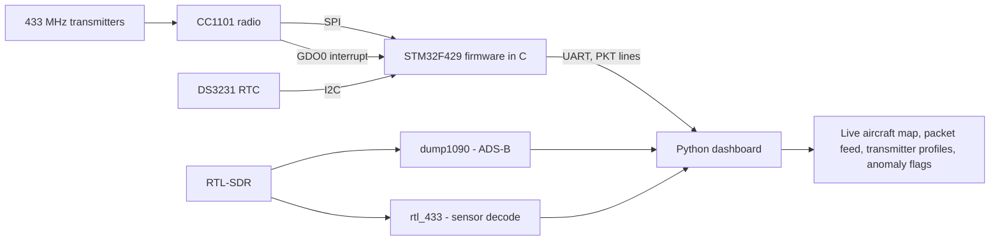

# SIGINT Station: 433 MHz RF Receiver + ADS-B Aircraft Tracker

A summer 2026 side project (June to August): two radio receivers feeding one Python dashboard, built to see what's actually on the air around Boulder.

- **Embedded receiver (STM32 + CC1101):** catches 433 MHz packets, timestamps them with a real-time clock, and streams them to a laptop over UART. The CC1101 driver is C built on the STM32 HAL SPI functions.
- **SDR receiver (RTL-SDR + dump1090 / rtl_433):** tracks live aircraft over ADS-B (1090 MHz) and decodes known 433 MHz sensors so packets can be matched to real devices.


## How it fits together



The STM32 handles everything real-time: radio setup, interrupt-driven packet capture, timestamps. The laptop handles parsing, identification, and display. Code was drafted with AI assistance (Claude); the architecture, wiring, testing, and debugging below were done by hand. The two sides talk over one text line per packet:

```
PKT,<length>,<RSSI dBm>,<LQI>,<YYYY-MM-DD HH:MM:SS>,<hex payload>
```

## Debugging notes

The four problems that ate the most time.

**1. Receiver locking up after bursts of packets.**
Reception would just die. Reading the CC1101's MARCSTATE and RXBYTES registers showed the chip parked in IDLE with an empty FIFO. The existing overflow check only looked at the overflow bit in RXBYTES, so it missed this case. Fix: check MARCSTATE at the top of the main loop, and if the chip isn't in RX, flush the FIFO and go back to RX.

**2. Packets stopping whenever a serial reader connected.**
Opening the port with `screen` or pyserial killed all packet capture. A loop heartbeat showed the program wasn't frozen, the debug console stopped too (so not a UART-only issue), and disabling DTR/RTS did nothing. MARCSTATE and RXBYTES showed the radio sitting in RX with nothing arriving. Best guess: electrical noise from SPI polling every 10 ms on unshielded jumper wires. Switching to interrupt-driven detection (GDO0 to an EXTI interrupt) removed the polling and fixed it. The exact electrical mechanism never got pinned down.

**3. Interrupt never firing.**
After the switch to interrupts, the GDO0 interrupt did nothing even though the FIFO clearly held packets. A later GPIOG init (for the on-board LCD) was overwriting the pin config inside `MX_GPIO_Init()`. Moving the GDO0 setup to the end of that function fixed it.

**4. RTC not responding on I2C.**
An I2C scan reported a phantom device at 0x41, even with the DS3231 unplugged. Adding pull-ups and swapping in a second module changed nothing. Per-wire continuity testing with a multimeter finally showed a dead SDA jumper. One new wire fixed it.

## Results and limitations

- Early sessions: 120+ packets from nearby 433 MHz devices, RSSI from about -20 to -128 dBm, lengths from 4 to 61 bytes.
- ADS-B tracking works end to end: live aircraft on the map with callsign, altitude, and speed.
- Most 433 MHz packets stay unidentified. Local devices seem to use rolling codes or proprietary encoding, and byte-pattern fingerprinting couldn't reliably group repeat transmitters. Weather-station transmitters were identified by matching packets against `rtl_433` decodes.
- The anomaly engine (new transmitter, RSSI spike, burst) is experimental. It needs stable device IDs, which only exist for devices `rtl_433` can decode.
- A few packets still show impossible positive RSSI values from a FIFO timing quirk. The dashboard swaps those for -99 as a workaround.

## Hardware

| Part | Purpose |
|---|---|
| STM32F429I-DISC1 | Microcontroller |
| CC1101 module | 433 MHz receiver |
| DS3231 module | Real-time clock |
| RTL-SDR V3 | ADS-B and sensor decoding |

Pins: CC1101 on SPI4 (SCK PE2, MISO PE5, MOSI PE6, CS PE4), GDO0 on PG2. DS3231 on I2C3 (SCL PA8, SDA PC9). UART1 to the laptop over the ST-LINK virtual COM port at 115200 baud.

## Source

Full firmware and dashboard code is in a private repo. Happy to share it on request.
